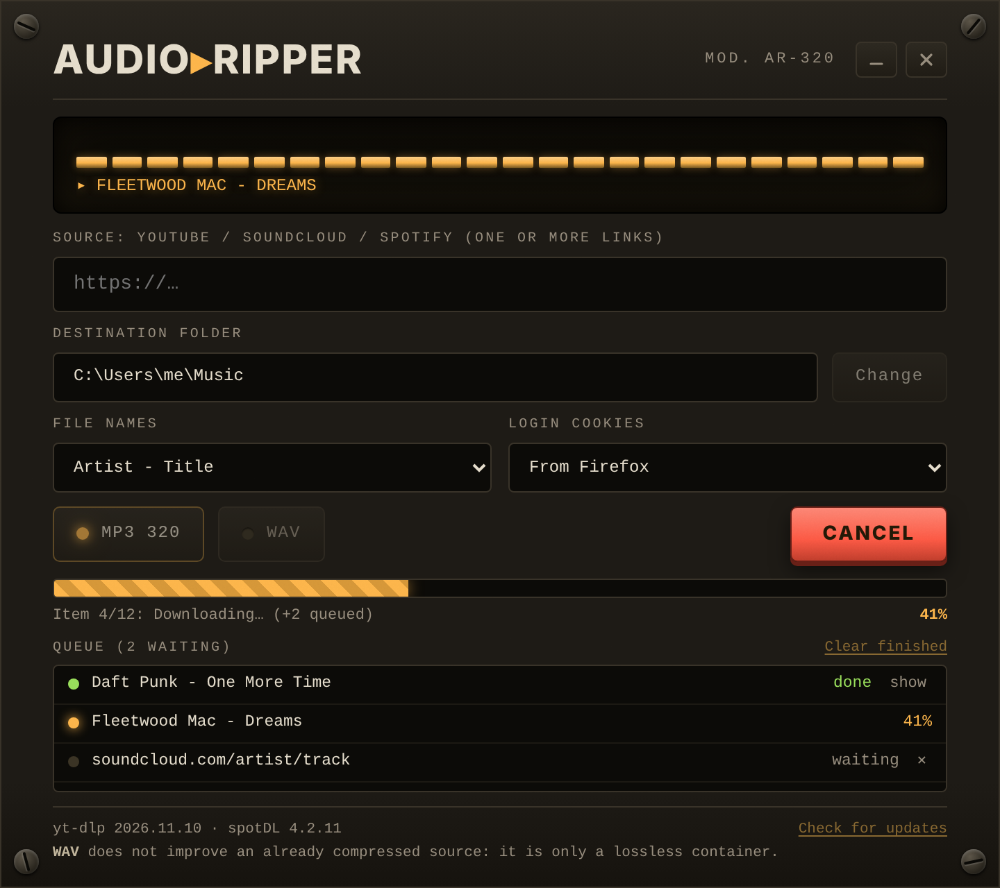
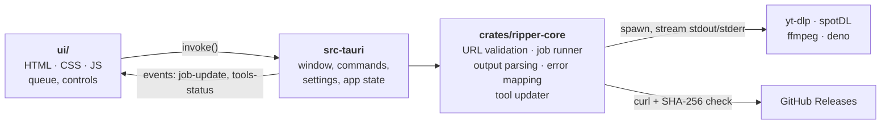

# Audio Ripper

**A fast, lightweight desktop app that turns YouTube, SoundCloud and Spotify links into
MP3 320 kbps or WAV files.** Written in Rust with Tauri 2, for Windows and macOS.

[](https://github.com/DetectiveOwl/audio-ripper/actions/workflows/ci.yml)
[](https://github.com/DetectiveOwl/audio-ripper/releases/latest)


<p align="center">
  
</p>

Paste one or more links, press **Extract audio**, and the files land in your Music folder,
tagged and with cover art. There is no server and no account. The app runs entirely on
your computer, opens instantly, and leaves nothing running when you close it.

## Highlights

- **Queue and playlists.** Several links are processed one at a time. A YouTube playlist or
  SoundCloud set is saved to its own subfolder with numbered tracks and overall progress.
- **Stays working on its own.** YouTube changes often and an outdated downloader stops
  working within weeks, so the app updates yt-dlp and spotDL by itself. Every download is
  checked against a SHA-256 and test-run before it replaces the old copy.
- **Clean process lifecycle.** Closing the window or pressing Cancel always stops the whole
  process tree (yt-dlp, ffmpeg, spotDL), even halfway through a conversion.
- **Errors a person can act on.** "Private video", "age-restricted: pick your browser under
  Login cookies" or "check your connection" replace raw stack traces.
- **Small and quick.** A 3.4 MB executable, no framework or bundler, a UI in plain
  HTML/CSS/JS, and update checks that wait until the window is already up.

## Download

Get the latest version from the [**Releases** page](../../releases/latest):

| Your computer | File |
|---|---|
| **Windows** (installer, no admin rights needed) | `AudioRipper-Windows-setup.exe` |
| **Windows** (portable, unzip and run) | `AudioRipper-Windows-portable.zip` |
| **Mac with an Apple chip** (M1 or newer) | `AudioRipper-macOS-apple-silicon.zip` |
| **Mac with an Intel processor** | `AudioRipper-macOS-intel.zip` |

The apps are not signed with a paid certificate, so the first launch shows a security
warning. On Windows click **More info**, then **Run anyway**. On macOS right-click the app,
choose **Open** and confirm. If macOS says the app is damaged, run
`xattr -cr "/Applications/Audio Ripper.app"` once in Terminal.

## Architecture



The code is split so that the interesting logic can be tested without a window:

- **`crates/ripper-core`** knows nothing about Tauri. It takes a URL, a format and a
  folder, runs the right tool, parses its output line by line and reports progress
  through a callback. It also owns the updater and the error mapping.
- **`src-tauri`** is a thin shell. It holds the window, the folder and file pickers, the
  persisted settings and a small state machine (`Idle | Job | Updating`), so a tool is never
  replaced while a download is using it.
- **`ui/`** is plain HTML, CSS and JS with no build step. The queue lives here, and the
  backend only ever runs one job at a time.

## Engineering notes

**No orphan processes.** On Windows the app places itself in a **Job Object** with
`KILL_ON_JOB_CLOSE` at startup, so the OS kills every child when the app exits, even if it
crashes. macOS has no Job Objects, so each child leads its own **process group**. The app
keeps a registry of running groups and kills them on exit. Cancel kills the whole tree on
both platforms (`taskkill /T` or `killpg`), and a test checks that a grandchild process is
really gone.

**Self-updating dependencies, safely.** The bundled tools are only a starting point.
Updated copies live in a writable data folder and take priority over the bundled ones.
yt-dlp updates itself (`-U` verifies its own checksum). spotDL is downloaded from its latest
GitHub release, checked against the SHA-256 digest GitHub publishes, started once with
`--version`, and only then moved into place, so a broken download never replaces a working
tool. A new version of the app discards these copies, because its own bundled tools are
newer. Downloads go through the system `curl`, which keeps an HTTP/TLS stack out of the
binary. The check runs at most once a day, a few seconds after launch, so startup stays
instant.

**Watching processes that do not cooperate.** yt-dlp and spotDL are Python programs that
write progress bars with `\r` and sometimes go silent. The reader treats `\r` and `\n`
both as line ends, and a watchdog stops a job only after 5 minutes with **no bytes at
all**, so a long conversion is never mistaken for a hang.

**Input is untrusted.** URLs are parsed and checked against a host allowlist before
anything runs, which also blocks argument injection such as `--exec=...` passed as a
"link". Arguments are passed as an array (never through a shell), the web view runs under
a strict CSP, and the UI builds DOM nodes with `textContent` only.

**Build integrity.** The build scripts check every downloaded tool against the checksum
its publisher provides (yt-dlp's `SHA2-256SUMS`, deno's `.sha256sum`, gyan.dev's ffmpeg
hash, GitHub asset digests) and stop on a mismatch.

## Testing and CI

`cargo test -p ripper-core` runs **39 tests** on any OS. The integration tests swap the
real tools for small **fake executables** (shell scripts that print what yt-dlp or spotDL
would print), which makes them fast and deterministic and lets them cover cases that are
hard to reproduce against the real sites:

- playlist progress, partial failures and already-downloaded files
- the stall watchdog, including a progress bar that redraws with `\r` and never prints `\n`
- cancellation killing children and grandchildren
- the exact arguments passed (tags, cover art, cookies, output templates)
- the updater: yt-dlp self-update, spotDL download and install, and **rejection of a file
  whose checksum does not match**

GitHub Actions runs the tests and type-checks the core for Windows and macOS on every pull
request, and builds the macOS app for both architectures. The **Release** workflow builds
everything and publishes a GitHub Release with clearly named files. It starts from a tag
push or from the Actions tab with a version number.

## Tech stack

| Area | Choice |
|---|---|
| Language | Rust 2021 |
| Desktop shell | Tauri 2 (WebView2 on Windows, WKWebView on macOS) |
| Async runtime | Tokio (process spawning, pipes, timeouts) |
| Platform APIs | `windows-sys` (Job Objects), `libc` (process groups) |
| UI | HTML, CSS, vanilla JavaScript, no framework or bundler |
| Media tools | yt-dlp, spotDL, ffmpeg, deno (bundled as Tauri sidecars) |
| CI/CD | GitHub Actions: tests, cross-target checks, Windows and macOS builds, releases |

## Project structure

```
crates/ripper-core/      core logic, no UI
  src/lib.rs             URL validation, formats, playlist detection
  src/runner.rs          runs a job: spawn, stream, parse, cancel, watchdog
  src/parse.rs           line parsers for yt-dlp and spotDL output
  src/errors.rs          raw tool errors -> short actionable messages
  src/update.rs          daily self-update of yt-dlp and spotDL
  src/jobobject.rs       Windows Job Object
  src/children.rs        process-group registry (macOS, Linux)
  tests/                 integration tests with fake tools
src-tauri/               Tauri shell: commands, settings, events
ui/                      interface (HTML, CSS, JS)
scripts/                 download and verify the bundled tools
.github/workflows/       CI, builds, release
```

## Using it

Paste one or more links separated by spaces and press **Extract audio**. You can add
links while a download is running. **Cancel** stops the current download and pauses the
queue, and **Extract audio** resumes it.

A playlist link (`youtube.com/playlist?list=...`) or a SoundCloud set is saved to a subfolder
named after the playlist. A video link that also carries `list=` downloads only that
video. MP3 files get tags and the cover picture. Under **File names** you can choose
`Title` or `Artist - Title` (the artist is added only when the site provides it).

**Login cookies.** Age-restricted or members-only videos, or a YouTube "confirm you're not a
bot" check, need a logged-in account. Pick the browser you are logged in with and yt-dlp
reads its cookies. Firefox works best, and Chrome or Edge can refuse while they are open.
You can also import a `cookies.txt` file (Netscape format). It is stored in the app's
settings folder and also used for Spotify links.

**Updates.** The footer shows the yt-dlp and spotDL versions in use and has a **Check for
updates** button. Updated tools live in `%LOCALAPPDATA%\dev.audioripper.app\bin` on Windows
and `~/Library/Application Support/dev.audioripper.app/bin` on macOS.

WAV output does not improve an already compressed source: from that point on it is only a
lossless container.

## Building from source

The core and its tests build on any OS:

```bash
cargo test -p ripper-core
```

**Windows** (Rust, Node.js, PowerShell):

```powershell
./scripts/fetch-binaries.ps1          # downloads and verifies yt-dlp, ffmpeg, spotDL, deno
npx @tauri-apps/cli@2 dev             # development window
npx @tauri-apps/cli@2 build           # installer in target/release/bundle/nsis
```

**macOS** (Rust, Node.js, Xcode command line tools):

```bash
./scripts/fetch-binaries.sh                      # downloads and verifies the tools
npx @tauri-apps/cli@2 dev                        # development window
npx @tauri-apps/cli@2 build --bundles app        # .app in target/release/bundle/macos
```

**Publishing a release:** run the **Release** workflow from the Actions tab and type the
version (for example `v0.2.0`), or push a tag with `git tag v0.2.0 && git push origin v0.2.0`.

## Roadmap

- Auto-update for the app itself (Tauri updater with signed release manifests)
- Read the app version from the release tag, so it cannot drift from `tauri.conf.json`
- Drag and drop of links, a paste button and a notification when the queue finishes
- Type-check the Tauri shell in CI, not only the core

## Responsible use

Audio Ripper is a personal project built to explore desktop engineering in Rust. Download
only content you have the right to save, and respect the terms of the sites you use.
